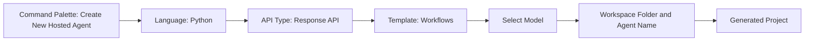
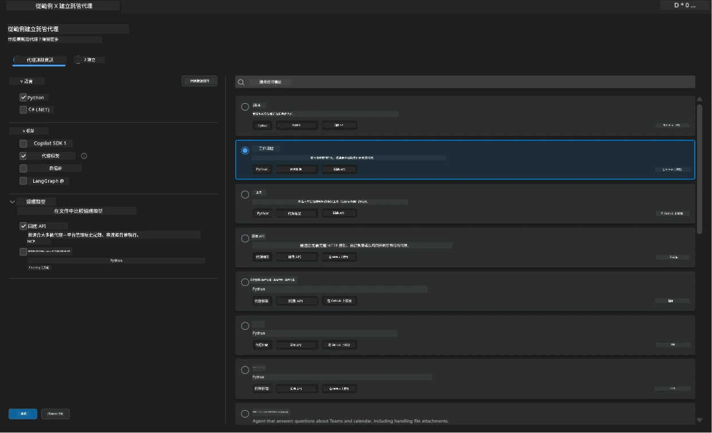
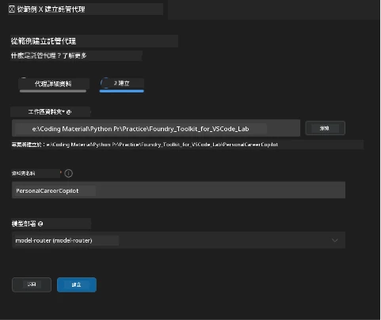

# 模組 2 - 建立多代理專案骨架

⏱️ 約 5 分鐘

在此模組中，您將使用 [Foundry Toolkit for VS Code](https://aka.ms/foundrytk) 來 <strong>搭建多代理專案的框架</strong>。此精靈會產生 `agent.yaml`、`main.py`、`Dockerfile`、`requirements.txt`、`.env` 以及 VS Code 除錯設定，讓您能專注在第 3 模組中連接 4 代理的工作流程。

> **關鍵概念：** 此框架是包含一個代理的運作範本。您會在第 3 模組中用 `WorkflowBuilder` 圖取代占位邏輯。您無需從頭撰寫樣板程式碼。

> **參考實作：** [`PersonalCareerCopilot/`](../../../../../workshop/lab02-multi-agent/PersonalCareerCopilot) 是一個完整可運作的範例。您可以在進行時拿來對照。

### 框架精靈流程



---

## 步驟 1：開啟建立託管代理精靈

1. 按下 `Ctrl+Shift+P` 開啟 <strong>指令選單</strong>。
2. 輸入：**Foundry Toolkit: Create new Hosted Agent** 並選擇它。
3. 精靈會在 <strong>代理詳細資料</strong> 標籤中開啟。

> **替代方式：** 點擊活動欄中的 **Foundry Toolkit** 圖示 → 點擊 **Hosted Agents** 旁的 **+** 圖示 → **Create New Hosted Agent**。

---

## 步驟 2：選擇設定



1. 在左側導覽/選項區域選擇以下項目：

| 功能表 | 選擇 | 備註 |
|--------|---------|-------|
| <strong>語言</strong> | Python | 亦支援 C# (.NET) |
| <strong>框架</strong> | 代理框架 | 提供 `Agent`、`AgentExecutor`、`WorkflowBuilder` |
| **API 類型** | 回應 API | `POST /responses` - 平台管理的歷史記錄、串流支援 |
| <strong>範本</strong> | <strong>工流程</strong> | 依序通過多個代理處理請求 |

2. 選擇完成後，點擊 <strong>下一步</strong>



3. 在下一個視窗中選擇以下項目：

| 功能表 | 選擇 | 備註 |
|--------|---------|-------|
| <strong>工作區資料夾</strong> | 瀏覽至目標資料夾 | 例如此程式碼庫中的 `workshop/lab02-multi-agent/` |
| <strong>代理名稱</strong> | `PersonalCareerCopilot` | 這會成為專案目錄名稱 |
| <strong>模型部署</strong> | 選擇您部署的模型 | 例如 Lab 01 的 `gpt-4.1-mini` |

4. 點擊 <strong>建立</strong> 以搭建專案框架。VS Code 會產生檔案並開啟資料夾。

> **提示：** [`gpt-4.1-mini`](https://learn.microsoft.com/azure/foundry/foundry-models/concepts/models-sold-directly-by-azure#gpt-41-series) 在多代理開發中平衡了速度與品質表現。

---

## 步驟 3：檢查產生的專案

架構完成後，確認在檔案總管中看到這些檔案 (`Ctrl+Shift+E`)：

```
📂 <your-agent-name>/
├── .azdignore          ← Files excluded from Azure Developer CLI deployments
├── .dockerignore       ← Files excluded from Docker builds
├── .env                ← Environment variables (placeholders - fill in Module 3)
├── .vscode/
│   ├── launch.json     ← Debug config (F5 → run + Agent Inspector)
│   └── tasks.json      ← VS Code task definitions
├── agent.yaml          ← Agent definition (kind: hosted, protocol: responses)
├── Dockerfile          ← Container config for deployment
├── main.py             ← Stub agent entry point (replace with WorkflowBuilder in Module 3)
└── requirements.txt    ← Python dependencies
```

> **重要：** 直接在 VS Code 打開此框架資料夾，以確保 `.vscode/launch.json` 和 `tasks.json` 在 F5 除錯時能正確運作。

### 重要檔案說明

| 檔案 | 目的 |
|------|---------|
| `agent.yaml` | 聲明 `kind: hosted`，映射環境變數，定義 `/responses` 協議 |
| `main.py` | Stub：一個 `FoundryChatClient` → `Agent` → `ResponsesHostServer`。你將在模組 3 中用 4 個代理人 + `WorkflowBuilder` 來取代此處 |
| `Dockerfile` | `python:3.12-slim`，安裝 `requirements.txt`，開放埠口 8088，執行 `python main.py` |
| `requirements.txt` | `agent-framework-foundry`，`agent-framework-foundry-hosting`，`mcp<2,>=1.24.0`，`debugpy` |

> **參考資料：** 請參閱 [`PersonalCareerCopilot/agent.yaml`](../../../../../workshop/lab02-multi-agent/PersonalCareerCopilot/agent.yaml) 及 [`PersonalCareerCopilot/requirements.txt`](../../../../../workshop/lab02-multi-agent/PersonalCareerCopilot/requirements.txt) 以獲得完整產生內容。

---

### ✅ 核心檢查點

- [ ] 搭建向導完成 - 新專案資料夾在瀏覽器中可見
- [ ] 所有預期檔案皆在：`agent.yaml`、`main.py`、`Dockerfile`、`requirements.txt`、`.env`
- [ ] `agent.yaml` 顯示 `kind: hosted` 及 `protocol: responses`
- [ ] `main.py` 匯入 `Agent`、`FoundryChatClient`、`ResponsesHostServer`
- [ ] 搭建的資料夾已開啟為 VS Code 工作區根目錄
- [ ] 你理解 `main.py` 是一個 Stub - `WorkflowBuilder` 將在模組 3 中加入

---

**先前章節：** [01 - 了解多代理架構](01-understand-multi-agent.md) · **下一章節：** [03 - 配置代理及環境 →](03-configure-agents.md)

---

<!-- CO-OP TRANSLATOR DISCLAIMER START -->
**免責聲明**：
此文件已使用 AI 翻譯服務 [Co-op Translator](https://github.com/Azure/co-op-translator) 進行翻譯。雖然我們努力追求準確性，但請注意自動翻譯可能包含錯誤或不準確之處。原始文件的母語版本應視為權威來源。對於關鍵資訊，建議採用專業人工翻譯。我們不對因使用此翻譯所產生的任何誤解或誤譯承擔責任。
<!-- CO-OP TRANSLATOR DISCLAIMER END -->